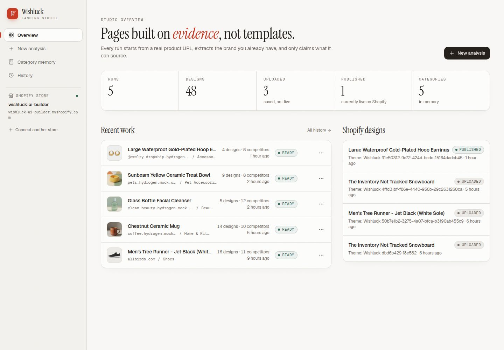

# Five-product evidence

Generated: 2026-11-11T19:18:05.893Z (UTC). Source: actual saved runs; no new Shopify writes.

The owner requested existing evidence only and excluded the video. Missing audits are **not** passes. Draft-preview credentials/hostnames, query tokens and headers are redacted from archived report exports; numeric results and timestamps are retained.



| Product | Category | Saved designs | Crawled competitors | Captures | Actual native Lighthouse |
|---|---|---:|---:|---:|---|
| [Large Waterproof Gold-Plated Hoop Earrings](large-waterproof-gold-plated-hoop-earrings/README.md) | Accessories | 4 | 8 | 12 | 93 performance / 69 SEO / 97 accessibility |
| [Sunbeam Yellow Ceramic Treat Bowl](sunbeam-yellow-ceramic-treat-bowl/README.md) | Pet Accessories | 9 | 8 | 12 | Not run — existing-evidence-only scope |
| [Glass Bottle Facial Cleanser](glass-bottle-facial-cleanser/README.md) | Beauty | 5 | 8 | 12 | Not run — existing-evidence-only scope |
| [Chestnut Ceramic Mug](chestnut-ceramic-mug/README.md) | Home & Kitchen | 14 | 8 | 12 | 95 performance / 69 SEO / 97 accessibility |
| [Men's Tree Runner - Jet Black (White Sole)](mens-tree-runners/README.md) | Shoes | 16 | 7 | 12 | 86 performance / 69 SEO / 93 accessibility |

## What is and is not verified

- **60 responsive design screenshots:** four directions × five products × three widths.
- All 60 captures had no detected horizontal overflow and all image elements loaded. See individual measurement files; this does not certify every native interaction or text-crop condition.
- Saved research, brand observations, source-linked learnings and complete fingerprints are included.
- Three source-product runs have real archived mobile Lighthouse reports. Two products have no storefront report. Additional historical shoe-run audits target a different selected store product and are labelled accordingly.
- Some protected draft previews scored SEO 69 with crawlability failures; those are not marked as passes. Native reports that met the targets are preserved, not generalized to all products.
- JSON-LD parsing/shape checks passed for the captured previews, but **Google Rich Results Test is not verified**.
- No blanket pass is claimed for all native variants, cart behavior or staff-editor changes across five products.
- Store credentials and signed draft-preview links must be supplied privately; see [reviewer access](../REVIEWER_ACCESS.md).

## Reproduce

Run the normal test/typecheck commands in the root README. With the existing application and database configured, run:

```sh
node scripts/package-submission.mjs --origin https://YOUR_RUNNING_PREVIEW
node scripts/index-submission.mjs
```

The exporter is read-only against Shopify. Screenshots and reports are a timestamped snapshot, not automatically updated by later merchant edits.
