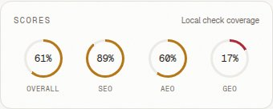

# Men's Tree Runner - Jet Black (White Sole)

- Category: Shoes
- [Public product source](https://www.allbirds.com/products/mens-tree-runners)
- **16 saved designs** and **12 responsive captures**.
- 11 linked research sources.
- Recorded cumulative AI estimate: **$0.1043** across this run's recorded work.

## Design scores and responsive previews

Overall/SEO/AEO/GEO values are saved **local page-check coverage** percentages. These dashboard HTML previews show four directions at each required width.

| Design | Overall | SEO | AEO | GEO | Mobile 360px | Tablet 768px | Desktop 1440px |
|---|---:|---:|---:|---:|---|---|---|
| Quiet angle archive | 61% | 89% | 60% | 17% | [Preview](design-1-360.jpg) | [Preview](design-1-768.jpg) | [Preview](design-1-1440.jpg) |
| Quiet Motion Ledger | 61% | 89% | 60% | 17% | [Preview](design-2-360.jpg) | [Preview](design-2-768.jpg) | [Preview](design-2-1440.jpg) |
| Quiet Horizon Ledger | 57% | 89% | 60% | 17% | [Preview](design-3-360.jpg) | [Preview](design-3-768.jpg) | [Preview](design-3-1440.jpg) |
| Monochrome Inspection File | 57% | 89% | 60% | 17% | [Preview](design-4-360.jpg) | [Preview](design-4-768.jpg) | [Preview](design-4-1440.jpg) |

## Research and design data

- [Brand analysis and recorded cost](brand-analysis.json)
- [Research sources, observations and linked learnings](research.json)
- [All design fingerprints and saved checks](design-fingerprints.json)
- [Responsive capture measurements](responsive-results.json)
- [Structured-data JSON and local validation results](schema-results.json)
- [Tracked Shopify records and unsigned links](shopify-results.json)

## Measured Shopify Lighthouse reports

Lighthouse measures storefront performance, SEO and accessibility separately from the local design scores above. Report links preserve the recorded scores and timestamps with private access details sanitized.

### Men's Tree Runner - Jet Black (White Sole) — report 1

**86 performance / 69 SEO / 93 accessibility**, recorded 2026-11-11T13:42:54.376Z.

[Score screenshot](lighthouse-1.jpg) · [Interactive report](lighthouse-1.html) · [Measurement data](lighthouse-1-summary.json)

### Development-store snowboard destination — report 2

**96 performance / 100 SEO / 96 accessibility**, recorded 2026-11-11T14:05:20.784Z.

[Score screenshot](lighthouse-2.jpg) · [Interactive report](lighthouse-2.html) · [Measurement data](lighthouse-2-summary.json)

### Development-store snowboard destination — report 3

**96 performance / 100 SEO / 96 accessibility**, recorded 2026-11-11T13:15:35.022Z.

[Score screenshot](lighthouse-3.jpg) · [Interactive report](lighthouse-3.html) · [Measurement data](lighthouse-3-summary.json)

