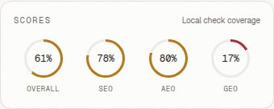

# Sunbeam Yellow Ceramic Treat Bowl

- Category: Pet Accessories
- [Public product source](https://pets.hydrogen.mock.shop/products/sunbeam-yellow-ceramic-treat-bowl)
- **9 saved designs** and **12 responsive captures**.
- 8 linked research sources.
- Recorded cumulative AI estimate: **$0.6266** across this run's recorded work.

## Design scores and responsive previews

Overall/SEO/AEO/GEO values are saved **local page-check coverage** percentages. These dashboard HTML previews show four directions at each required width.

| Design | Overall | SEO | AEO | GEO | Mobile 360px | Tablet 768px | Desktop 1440px |
|---|---:|---:|---:|---:|---|---|---|
| Sunlit Proof Ladder | 61% | 78% | 80% | 17% | [Preview](design-1-360.jpg) | [Preview](design-1-768.jpg) | [Preview](design-1-1440.jpg) |
| Sunny Split With Mid-Page Answers | 61% | 78% | 80% | 17% | [Preview](design-2-360.jpg) | [Preview](design-2-768.jpg) | [Preview](design-2-1440.jpg) |
| Bright Buy-Box Showcase With Answer-First Flow | 65% | 89% | 80% | 17% | [Preview](design-3-360.jpg) | [Preview](design-3-768.jpg) | [Preview](design-3-1440.jpg) |
| Bright Rail With Evidence-First Close | 61% | 78% | 80% | 17% | [Preview](design-4-360.jpg) | [Preview](design-4-768.jpg) | [Preview](design-4-1440.jpg) |

## Research and design data

- [Brand analysis and recorded cost](brand-analysis.json)
- [Research sources, observations and linked learnings](research.json)
- [All design fingerprints and saved checks](design-fingerprints.json)
- [Responsive capture measurements](responsive-results.json)
- [Structured-data JSON and local validation results](schema-results.json)
- [Tracked Shopify records and unsigned links](shopify-results.json)
